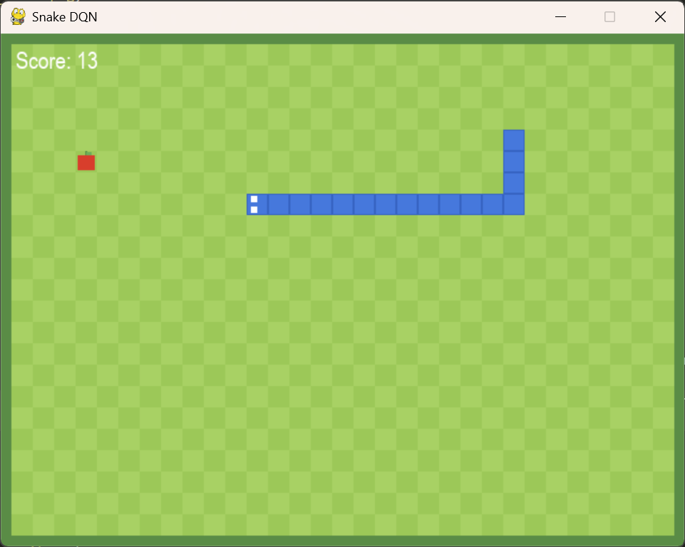
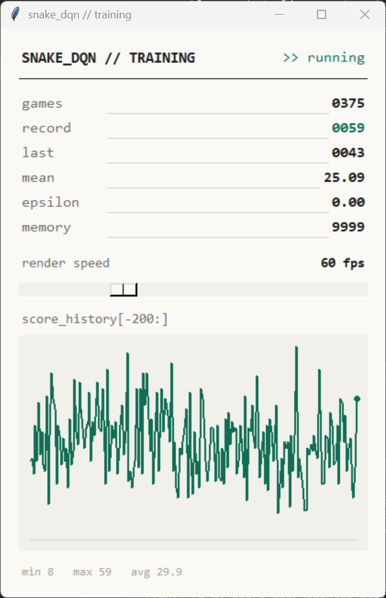

# neurosnake

A Deep Q-Network (DQN) that learns to play Snake through reinforcement learning — with a custom pygame game view and a live Tkinter training dashboard.

## Screenshots




## Setup

```bash
python -m venv venv
venv\Scripts\activate      # on Mac/Linux: source venv/bin/activate
pip install torch pygame numpy
```

## Run

```bash
python agent.py
```

This opens two windows:
- **Game window** — the snake playing live, pixel-art style
- **Dashboard** — live training stats (games played, record, mean score, epsilon) and a score history graph, with a render-speed slider

Training checkpoints save automatically every 25 games (and on every new record) to `./model/`, and resume automatically the next time you run the script.